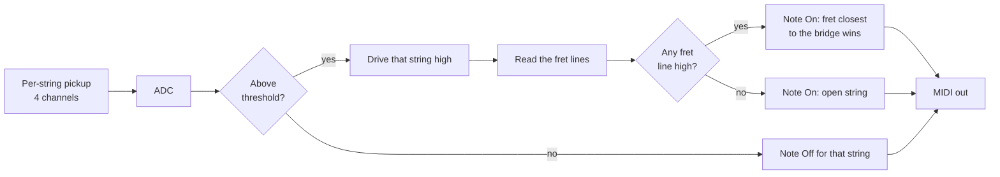

# TigerBass 2

A 4-string bass guitar that is also a MIDI controller. It plays as a normal bass, and it reports every fretted note, its velocity, and expression gestures as MIDI so the same instrument can drive a synth or a DAW.

LSU ECE Capstone Design Program, Project #70, Fall 2026 – Spring 2027. This is the second generation of Project 68 ("Tiger Bass 1", 2024–25).

> **Status: early design.** The new controller board has not been started. Anything marked `TBD(team)` is not decided yet. Do not treat it as a spec.

## What we are building

Tiger Bass 1 proved the idea: energise one string at a time, see which fret it touches, and send the note over USB when the string's pickup channel crosses a threshold. TigerBass 2 keeps that idea and rebuilds the electronics around it.

Project goals for this year:

- Lower note-on latency than Tiger Bass 1 (its target was 8 ms from pluck to MIDI packet).
- Vibrato / modulation from a scroll wheel, and pitch bend from a whammy bar.
- An integrated battery.
- A sleeker instrument, with the electronics designed into the body instead of wired into a cavity.
- Budget: $1000 (preliminary).

## Old board vs new board

We are remaking the controller board from scratch and carrying over the parts of the old design that worked.

| Area | Tiger Bass 1 (as built) | TigerBass 2 (target) | State |
| --- | --- | --- | --- |
| Fret sensing | 80 fret segments (20 frets × 4 per-string segments), one MCU input each, through 1 kΩ, over two 2×20 headers to the neck PCB | 20 full-width frets shared by all four strings, so 20 fret lines | Direction chosen |
| String drive | 4 GPIO outputs, one string driven high at a time, Schottky diode per string | Same scan principle | Needs ghosting analysis, see below |
| Amplitude sensing | 4 per-string pickup channels into a passive diode clamp, then the MCU's internal 12-bit ADC | A separate, dedicated ADC | Part `TBD(team)` |
| MCU | STM32F439ZIT6, LQFP-144, 8 MHz crystal | `TBD(team)`. The 144-pin package had room for 80+ inputs, which we no longer need | Open |
| USB | Micro-B, full-speed (OTG_FS), MIDI packets sent through a HID-class call | Proper USB-MIDI class; connector `TBD(team)` | Open |
| DIN MIDI out | UART → SN74LVC1G17 buffer → 33 Ω / 10 Ω → 3-pin header | `TBD(team)` | Open |
| Expression | 5 pot inputs: octave, modulation, pitch bend, MIDI channel, threshold | Scroll wheel (vibrato / modulation), whammy bar (pitch bend), others `TBD(team)` | Open |
| Power | 9 V rechargeable Li-ion → LT1763 3.3 V LDO | Integrated battery; power tree `TBD(team)` | Open |
| Mechanical | Boards and wiring in the body cavity, no ME on the team | Designed enclosure, 2 MEs on the team | Open |

Everything we know about the old board is collected in [`docs/legacy/tigerbass1-notes.md`](docs/legacy/tigerbass1-notes.md), including its pin map and a list of things in last year's material that contradict each other.

## How it works



The strings are the outputs of a switch matrix and the frets are the inputs. A string that is pressed onto a fret closes that switch. The pickup channel says *when* a string was plucked and how hard (velocity). The matrix says *which note* it is.

## Repository layout

```text
.
├── README.md
├── CONTRIBUTING.md
├── .github/
│   ├── copilot-instructions.md     standing instructions for GitHub Copilot
│   ├── workflows/                  CI
│   └── ISSUE_TEMPLATE/
├── hardware/
│   ├── controller-board/           KiCad project for the new controller PCB
│   ├── fret-board/                 KiCad project for the neck / fret PCB
│   ├── lib/                        project symbols, footprints, 3D models
│   └── sim/                        LTspice and other circuit simulations
├── firmware/
│   ├── app/                        portable C, no vendor headers, builds on a PC
│   ├── bsp/                        STM32 HAL glue and CubeMX-generated code
│   └── tests/                      unit tests that run on a PC
├── mechanical/                     exported STEP files and drawings
├── tools/                          scripts: note table, latency budget, BOM
├── docs/
│   ├── requirements.md
│   ├── architecture.md
│   ├── decisions/                  one short file per design decision
│   ├── analysis/                   trade studies and calculations behind the decisions
│   ├── legacy/                     notes on Tiger Bass 1
│   ├── copilot/                    prompts we give the Copilot agent
│   └── test/                       test plans, procedures, results
└── legacy/
    └── tigerbass1/                 last year's KiCad project and firmware, read-only
```

Every folder has a short `README.md` saying what belongs in it. New to Git? Start with [`CONTRIBUTING.md`](CONTRIBUTING.md).

## Getting set up

| Tool | Used for | Version |
| --- | --- | --- |
| Git, plus GitHub Desktop if you prefer a GUI | Everything | Current |
| KiCad | Schematics and PCB layout | Last year's files are KiCad 8.0.8. Team version `TBD(team)` |
| STM32CubeIDE | Firmware build, flash, debug | `TBD(team)` |
| LTspice | Circuit simulation | Current |
| CMake and a C compiler | Running the firmware unit tests on your PC | CMake 3.20 or newer |

Everyone must use the same KiCad major version. A newer KiCad rewrites files in a format an older one cannot open, so one person upgrading locks everyone else out.

```bash
git clone <repo-url>
cd <repo>
git switch -c hw/your-change     # or fw/..., mech/..., docs/...
# work, then
git add -A
git commit -m "ctrl: add ADC front end for string 1"
git push -u origin hw/your-change
# open a pull request on GitHub
```

## Working agreements

1. **`main` is always in a state we could order or flash from.** Nobody pushes to it directly. Changes go through a pull request with one review.
2. **Branch names say what kind of change it is:** `hw/…`, `fw/…`, `mech/…`, `docs/…`.
3. **One person edits a given KiCad file at a time.** Schematic and board files are text, but two people's edits to the same file cannot be merged in practice. Before you open a board or sheet to change it, say so on the issue for that work. Pull first, keep the change small, and open the PR the same day.
4. **Commit design files, not editor leftovers.** KiCad backups, autosaves and lock files stay out of Git (`.gitignore` covers them). Last year's repo had them checked in at one point.
5. **Every PR says how it was checked.** For hardware: ERC and DRC clean, or each remaining violation explained. For firmware: tests pass, and if it ran on the board, what you measured.
6. **Fabrication outputs come from a tag.** We never order boards from an untagged commit. A release such as `ctrl-revA` carries the gerbers, drill files, BOM, position file and a schematic PDF as release assets.
7. **Decisions are written down.** Anything in the "Open decisions" list below gets a short file in `docs/decisions/` when it is settled: what we chose, what we rejected, and why.
8. **Write PR descriptions so they can go straight into your design notebook.** What you did, why, and the evidence. That is most of a Quality Entry.

### Using Copilot

Copilot works on this repo as a background contributor. Its standing rules are in [`.github/copilot-instructions.md`](.github/copilot-instructions.md), and the tasks we hand it are in [`docs/copilot/`](docs/copilot/). Its pull requests are reviewed like anyone else's, and a teammate who understands the change approves it before it merges. It cannot open KiCad, touch hardware, or measure anything, so it does not make design decisions and it does not get the last word on a part choice.

Check the Capstone Design Program's policy on AI assistance before you put AI-written text in a graded report.

## Open decisions

Each has a record in [`docs/decisions/`](docs/decisions/) with the options and what we need to find out. Tick it here when its record says Decided.

- [ ] [**Shared-fret ghosting.**](docs/decisions/0001-shared-fret-ghosting.md) With full-width frets, a fret is a conductor common to all four strings. If a fretted string touches two frets (last year's analysis assumed the fret on each side of the finger both make contact), it bridges them. A second string fretted one position away can then carry the drive signal on to a fret the driven string is not touching, and the scan reports the wrong note. Tiger Bass 1's segmented frets could not do this. Needs analysis and a bench test before layout.
- [ ] [**External ADC part and interface.**](docs/decisions/0002-external-adc.md) Channel count, simultaneous sampling or fast multiplexing, sample rate, resolution, input range.
- [ ] [**Amplitude front end.**](docs/decisions/0003-amplitude-front-end.md) Last year's as-built circuit is a passive clamp with a series diode. Decide whether the new ADC gets a buffered front end.
- [ ] [**MCU.**](docs/decisions/0004-microcontroller.md) Keep the STM32F439 for firmware reuse, or move to a smaller package now that we need about 20 fret inputs instead of 80.
- [ ] [**Latency target.**](docs/decisions/0005-latency-target.md) Pick the number we are designing to, and how we will measure it.
- [ ] [**USB.**](docs/decisions/0006-usb.md) Connector, and which USB-MIDI stack.
- [ ] [**DIN MIDI out.**](docs/decisions/0007-din-midi-out.md) Keep or drop.
- [ ] [**Scroll wheel and whammy bar sensing.**](docs/decisions/0008-expression-sensing.md) Sensor type for each (encoder, potentiometer, Hall sensor), and which MIDI messages they send.
- [ ] [**Battery and power tree.**](docs/decisions/0009-battery-and-power-tree.md) Chemistry, charging, protection, run time target, how the pickups are powered.
- [ ] [**Board partition and connectors.**](docs/decisions/0010-board-partition-and-connectors.md) What lives on the controller board, what lives on the fret board, and how they connect now that it is 20 lines instead of 80.
- [ ] [**KiCad and CubeIDE versions**](docs/decisions/0011-tool-versions.md) the whole team installs.
- [ ] [**Where mechanical CAD lives.**](docs/decisions/0012-mechanical-cad-location.md) Native CAD files in this repo, or exports only.
- [ ] [**Licence**](docs/decisions/0013-licence.md), if the repo is ever made public.

## Team

| Name | Discipline | Team |
| --- | --- | --- |
| Raman Yadav | EE | PCB and Firmware |
| Jake Fernandez | EE | PCB |
| Joshua Wanga | EE | PCB and Firmware |
| Daniel Whitely | EE, ECE | PCB |
| Patrick Cangelosi | ECE | Firmware |
| Lance Captain | ECE | Firmware |
| Adam Magnus Stevens | ME | Mechanical |
| Reed Durst | ME | Mechanical |

Sponsor: Chris O'Loughlin. Faculty advisor: James Bonner.

Tiger Bass 1 was built by the 2024–25 Project 68 team: Mason Woessner, Connor Lirette, Grant Pennison and Ryan Reine.
