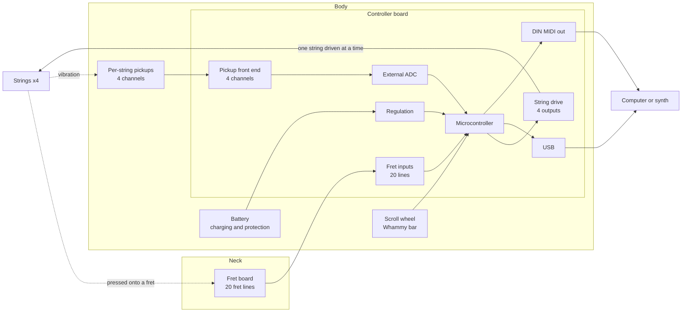
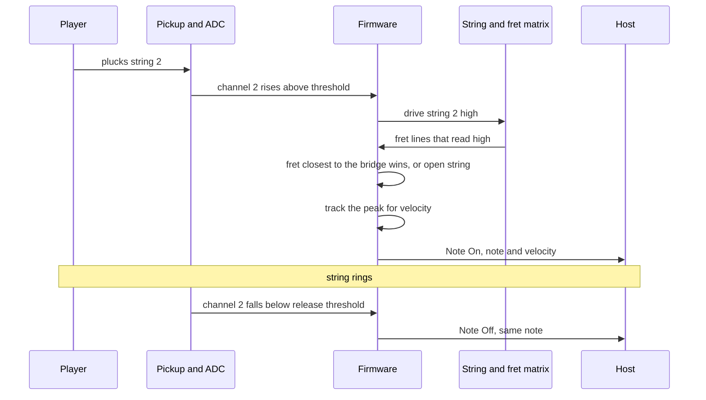
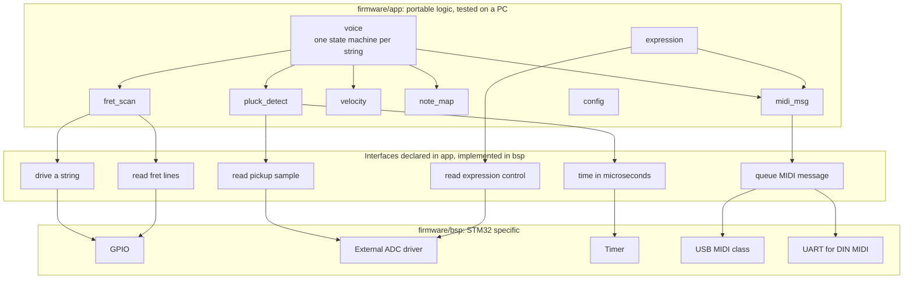

# Architecture

How TigerBass 2 is put together: the blocks, where each one lives, and what crosses between them.

**This describes the plan, not a finished design.** The blocks follow from the project goals and from how Tiger Bass 1 worked. The values in the tables are mostly `TBD(team)` because the decisions that set them are still open. Update this file whenever a decision in [`decisions/`](decisions/) is settled.

## The instrument

Dotted arrows are physical, not electrical: a string touching a fret, a string vibrating over a pickup.

Not shown: the bass's normal audio path, from its magnetic pickup to the output jack. Whether that path touches the controller board is an open question in [`requirements.md`](requirements.md#open-questions-about-the-requirements-themselves).

## What each block does

| Block | Job | Tiger Bass 1 | TigerBass 2 |
| --- | --- | --- | --- |
| String drive | Puts a voltage on one string at a time | 4 GPIO, each through a Schottky diode | Same principle. See [0001](decisions/0001-shared-fret-ghosting.md) |
| Fret board | Carries each fret's signal out of the neck | 80 lines, one per string segment of each fret | 20 lines, one per full-width fret |
| Fret inputs | Reads which fret lines are high while a string is driven | 80 GPIO, 1 kΩ series each, internal pull-downs | 20 lines. Protection and pull-down values `TBD(team)` |
| Pickups | One signal per string that rises when that string is plucked | 4 channels. The report and the as-built board disagree on type, see the legacy notes | `TBD(team)` |
| Pickup front end | Conditions the pickup signal for the ADC | Passive: series resistor, clamp diodes, series diode | See [0003](decisions/0003-amplitude-front-end.md) |
| ADC | Digitises the four pickup channels | Microcontroller's internal 12-bit ADC | External part. See [0002](decisions/0002-external-adc.md) |
| Microcontroller | Runs the scan, decides notes and velocities, builds MIDI | STM32F439ZIT6 | See [0004](decisions/0004-microcontroller.md) |
| Expression | Player controls beyond the strings | 5 potentiometers | Scroll wheel and whammy bar. See [0008](decisions/0008-expression-sensing.md) |
| USB | MIDI to a computer | Full-speed, Micro-B | See [0006](decisions/0006-usb.md) |
| DIN MIDI out | MIDI to hardware synths | UART through a buffer | See [0007](decisions/0007-din-midi-out.md) |
| Battery and regulation | Powers everything | 9 V rechargeable Li-ion, LDO to 3.3 V | See [0009](decisions/0009-battery-and-power-tree.md) |

## One note, start to finish

This is the sequence Tiger Bass 1 used, taken from its system flowchart. Two things in it are design choices the firmware can change without new hardware:

- **Whether to wait for the peak before sending Note On.** Waiting gives a better velocity and costs latency. Sending at the threshold crossing is faster and has to guess the velocity.
- **Whether to scan the frets only after a pluck, or continuously.** Scanning continuously means the fretted position is already known when the pluck arrives, and lets a hammer-on be detected without a pluck.

Each stage's contribution to latency is the subject of Prompt 6 in [`copilot/kickoff-prompt.md`](copilot/kickoff-prompt.md).

## Interfaces that cross a board boundary

Everything that leaves the controller board through a connector. This table is what the fret board designer, the mechanical engineers and the controller board designer have to agree on.

| Signal | Between | Count | Direction, seen from the controller | Level | Connector | State |
| --- | --- | --- | --- | --- | --- | --- |
| Fret lines | Fret board and controller | 20 | In | Follows the string drive voltage. 3.3 V on Tiger Bass 1 | `TBD(team)`. Was two 2×20 headers | Count depends on [0001](decisions/0001-shared-fret-ghosting.md) |
| Fret board ground or return | Fret board and controller | `TBD(team)` | n/a | 0 V | Same connector | Open |
| String drive | Controller and each string | 4 | Out | 3.3 V through a diode on Tiger Bass 1 | `TBD(team)`. Was a 1×4 header | Where the wire attaches to each string is `TBD(team)` |
| Pickup signal | Pickups and controller | 4 | In | `TBD(team)`. Needs measuring on the real pickup | `TBD(team)`. Was a 2×4 shrouded header with a ground beside each signal | Open |
| Pickup power | Controller and pickups | `TBD(team)` | Out | `TBD(team)`. Tiger Bass 1 had a 9 V output header | `TBD(team)` | Depends on the pickup |
| Scroll wheel | Sensor and controller | `TBD(team)` | In | `TBD(team)` | `TBD(team)` | [0008](decisions/0008-expression-sensing.md) |
| Whammy bar | Sensor and controller | `TBD(team)` | In | `TBD(team)` | `TBD(team)` | [0008](decisions/0008-expression-sensing.md) |
| Other controls | Body-mounted controls and controller | `TBD(team)` | In | `TBD(team)` | `TBD(team)` | Which of octave, MIDI channel and threshold are kept is open |
| USB | Controller and host | D+, D−, VBUS, ground, shield | Both | USB full-speed on Tiger Bass 1 | `TBD(team)`. Was Micro-B | [0006](decisions/0006-usb.md) |
| DIN MIDI out | Controller and synth | 1 current loop | Out | 3.3 V MIDI on Tiger Bass 1 | `TBD(team)` | [0007](decisions/0007-din-midi-out.md) |
| Battery | Battery and controller | 2, plus any sense lines | In | `TBD(team)`. Was 9 V | `TBD(team)` | [0009](decisions/0009-battery-and-power-tree.md) |
| Charging | Outside and battery | `TBD(team)` | In | `TBD(team)` | `TBD(team)` | [0009](decisions/0009-battery-and-power-tree.md) |
| Debug | Controller and programmer | SWDIO, SWCLK, SWO, reset, 3.3 V, ground | Both | 3.3 V | 2×5, 1.27 mm on Tiger Bass 1 | Keep unless the MCU changes family |

Questions this table raises for the mechanical side: which of these connectors must be reachable with the instrument assembled (USB, charging, MIDI out), which only during assembly (fret board, pickups, battery), and which only on the bench (debug).

## Firmware structure

Planned, not implemented. The reasons for the split are in [`firmware/README.md`](../firmware/README.md).

`H4` is drawn going to the ADC driver, but whether the expression controls share the external ADC, use the microcontroller's own ADC, or are digital (an encoder) is part of [0008](decisions/0008-expression-sensing.md).

## Keeping this file current

When a decision is recorded in [`decisions/`](decisions/), update the matching rows here in the same pull request. A `TBD(team)` that has an answer somewhere else in the repo is worse than one that has no answer, because it tells the reader nobody knows.
